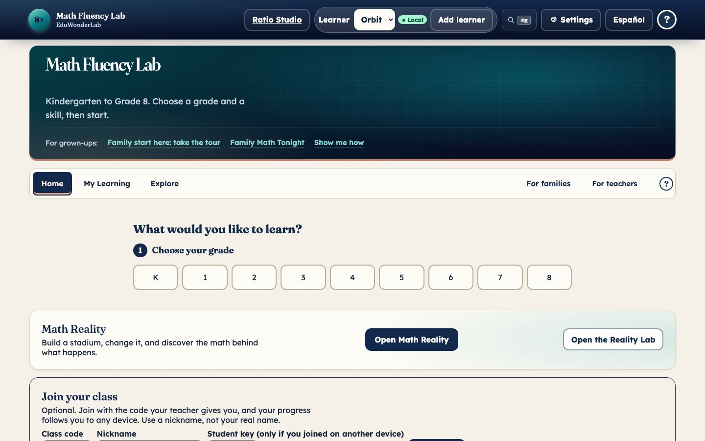
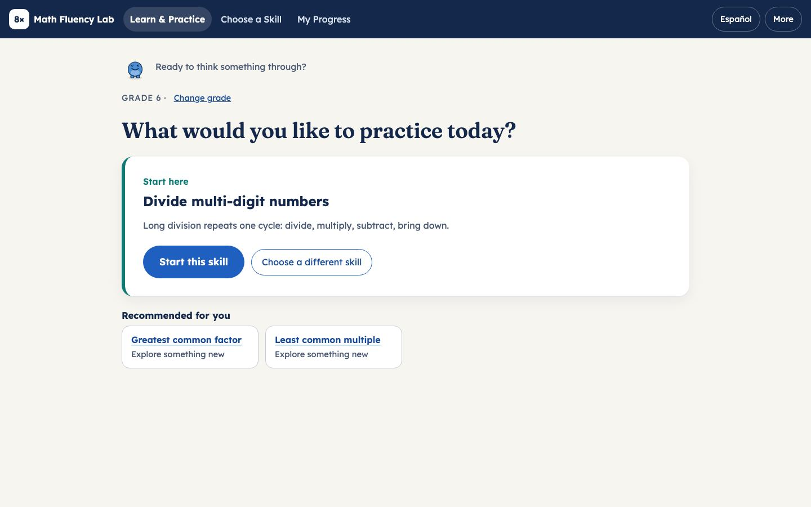
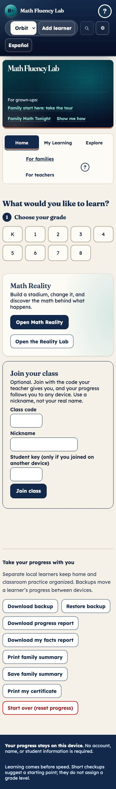
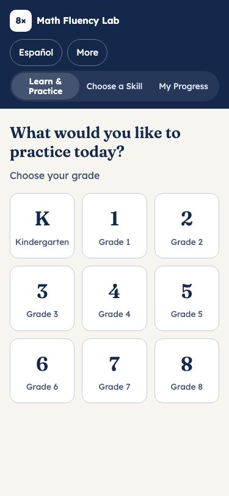

# Math Fluency Lab redesign — implementation and acceptance report

Date: 2026-11-12. Live site: https://eduwonderlab.com/math/fluency-lab/. Production build at the time of the final
measurements: `41bad3a6d6`. The old app is intact at `/math/fluency-lab/lab`.

The standard (Joel's words): "truly publisher-grade, top 1 percent of math practice and fluency sites"; "as flawless as
ixl and prodigy -- with innovations and enhancements"; "make sure the graphics/quality/clarity of text is of equal or
higher quality"; explanations and strategies must match the interactive boxes.

**Verdict in one paragraph.** The structure, coverage and accessibility of the new app are strong and measured on every
skill. It is not yet "top 1 percent" on three counts that are measured, not guessed: phone load time (LCP 3.4s home,
4.9s on a skill, against a 2.5s target, on the standard slow-4G / 4x CPU profile), 22 skills whose generated problems
have no picture in the help ladder, and Spanish that no native speaker has reviewed. Those are listed as work in
section 9, not footnotes.

## 1. What is live (main commits)

| Commit       | What                                                                                                                                                                                                                                                                                                                                                                                                                                                                  |
| ------------ | --------------------------------------------------------------------------------------------------------------------------------------------------------------------------------------------------------------------------------------------------------------------------------------------------------------------------------------------------------------------------------------------------------------------------------------------------------------------- |
| `aeef14e9da` | New student app: three destinations; See → Try → Practice → Understand; synchronized explanation canvas; help ladder that never prints the answer; adaptive practice, transfer, prerequisite review, "Another way"; preferences; library filters; EN/ES. Authored explanations, misconception detectors and living models for all 128 skills. Old app kept at `lab.html` (served as `/math/fluency-lab/lab`); teacher, assignment, game and tool links forward there. |
| `e6f98a0d43` | Explanation steps and the interactive column boxes / area model share one regrouping plan (`regroup-plan.js`, `multiply-plan.js`); `explanation-model-alignment.test.mjs` with a negative control.                                                                                                                                                                                                                                                                    |
| `2d05d13665` | Spanish labels inside math pictures (27,185 pictures checked).                                                                                                                                                                                                                                                                                                                                                                                                        |
| `9d0db672dd` | Legible picture labels at phone width.                                                                                                                                                                                                                                                                                                                                                                                                                                |
| `b7160ce219` | Mastery meter (independent first-try answers only; supported work counted separately), right-answer and milestone celebrations through the existing rewards record, buddy feedback that praises thinking, next-skill strip.                                                                                                                                                                                                                                           |
| `debeefa47c` | Spanish gaps closed: equation line, screen-reader descriptions, Explore simulators, hints/steps/explanations of generated problems, language button keeps the current skill and step.                                                                                                                                                                                                                                                                                 |
| `9f490db80b` | Defects found by the browser sweep: search, progress-screen reload, 320px overflow, 44px targets.                                                                                                                                                                                                                                                                                                                                                                     |
| `41bad3a6d6` | Skill screen loads on demand; saved-language state split from the dictionaries (home LCP 4.6s → 3.4s).                                                                                                                                                                                                                                                                                                                                                                |

## 2. Before and after

Before = the app that was in production until `aeef14e9da` (now `/math/fluency-lab/lab`). After = the new app.

|                    | Before                                                                 | After                                                       |
| ------------------ | ---------------------------------------------------------------------- | ----------------------------------------------------------- |
| Home, 1440px       |                 |        |
| First visit, phone |  |  |

More after screens: [first visit 1440](fluency-redesign-report/after-first-visit-1440.jpg),
[skill, See it, phone](fluency-redesign-report/after-skill-see-375.jpg),
[skill, See it, 1440](fluency-redesign-report/after-skill-see-1440.jpg),
[library](fluency-redesign-report/after-library-375.jpg),
[progress](fluency-redesign-report/after-progress-375.jpg),
[Spanish skill](fluency-redesign-report/after-skill-es-375.jpg),
[wrong answer with the picture, phone](fluency-redesign-report/after-practice-miss-picture-375.jpg),
[the same at 320px](fluency-redesign-report/after-practice-miss-picture-320.jpg).

## 3. Preservation report

Everything the full lab owned still answers. Production, anonymous visitor, Chromium (`evidence/preservation-production.json`):
**23 of 23** routes and parameters reach the lab and open their own view.

| Class            | Routes checked                                                                          | Result                                |
| ---------------- | --------------------------------------------------------------------------------------- | ------------------------------------- |
| The lab itself   | `lab`, `lab.html`                                                                       | open                                  |
| Lab views        | `?view=teacher`, `games`, `write`, `path`, `notebook`, `models`, `practice`, `progress` | each opens its own view (own heading) |
| Starts           | `?start=daily`, `mission`, `checkup`, `realworld`; `stage=play`                         | open the lab                          |
| Assignment links | `#assignment=`, `#factplan=`, `#videos`, `#board=`                                      | open the lab with the hash intact     |
| Other            | `?diagnostics`, `?publisher-demo`, `?tour`, `?profile`                                  | open the lab                          |

Notes: the teacher view loads three teacher assets that answer 401 to an anonymous visitor, by design (teacher
surfaces are gated). `?view=progress` still forwards to the old lab; the new app's own progress screen now writes
`?view=my-progress` so reloading it stays in the new app (that was a real defect, section 6).

Feature inventory (the More drawer, verified on production): **Core** (the app itself): Learn & Practice, Choose a Skill,
My Progress. **Contextual**: Daily mix, Starting-point checkup, Progress report and printing, Back up or restore progress,
Learner on this device. **Teacher / family**: Teacher studio, Family Math Expedition, Full lab. **Enrichment**: Game Room,
Ratio Studio, Math Reality, Math tools and models, Math Writing Studio. Settings: Larger text, Reading font, Reduce
motion, Read aloud.

Not re-verified in this pass: print output, SCORM packaging, end-to-end assignment completion. Storage keys are shared
with the old lab (the meter and awards write through the existing `ewl-fluency-rewards-v1` record; a backup round trip is
tested in `meter-awards.test.mjs`).

## 4. Coverage report (128 skills)

Full table: [fluency-redesign-coverage.md](fluency-redesign-coverage.md). Summary, measured from the code:

| Measure                                                            | Result                                                                                   |
| ------------------------------------------------------------------ | ---------------------------------------------------------------------------------------- |
| Skills                                                             | 128 (K–8)                                                                                |
| Concept statement, worked example, transfer problem, Spanish title | 128 / 128 each                                                                           |
| Try it                                                             | 35 living models + 93 engine builds, 0 guided fallbacks                                  |
| Misconception detectors                                            | 128 / 128 skills, 286 detectors                                                          |
| Problems drawn by a studio engine                                  | 106 of 128 skills; **22 skills have none** (help ladder is a hint and steps, no picture) |

Every skill was also opened from a direct link, in every step and both languages (section 5).

## 5. Test and measurement results

**Browser sweep, production `41bad3a6d6`** (Chromium; scripts and raw results in `fluency-redesign-report/evidence/`).

| Check                                                                                                                    | Result                                                                                                                                                 |
| ------------------------------------------------------------------------------------------------------------------------ | ------------------------------------------------------------------------------------------------------------------------------------------------------ |
| Journeys 1–7 × 320/375/768/1024/1440 × EN/ES                                                                             | **70 / 70 pass**                                                                                                                                       |
| axe WCAG 2.0/2.1/2.2 A+AA on 120 journey page states                                                                     | **0 serious or critical**                                                                                                                              |
| All 128 skills × (See, Try, Practice in EN; See, Practice in ES) at 375px, axe on each                                   | **640 / 640 clean**, 0 serious or critical                                                                                                             |
| Same at 1440px                                                                                                           | 634 / 640 on the first run; the 6 misses were 30-second navigation timeouts while the run was slow; all 6 passed on retry (1.0–1.7s, axe 0, console 0) |
| Console errors, failed requests, horizontal overflow, keyboard traps, tab stops with no focus ring, tab stops under 44px | **0 findings**                                                                                                                                         |

The journeys: 1 first visit (grade chooser K–8, nothing preselected, one primary action, grade → skill in 2 actions);
2 library (search with everyday words, filters, Start); 3 fresh device, direct practice link, answer with the keyboard
only; 4 returning learner (one Continue action, grade shown); 5 Kindergarten pre-reader (read-aloud control and a
picture on the skill); 6 shared Grade 6 link, language switch keeps the skill and step; 7 progress, More drawer,
forwarding to the full lab.

**Core Web Vitals (lab, production).** Phone profile = 375px, 4x CPU slowdown, 150ms latency, 1.6 Mbps (the usual
"slow 4G" lab preset). Desktop = 1440px, no throttling. INP is the longest interaction duration seen in the run (3–8
interactions), not a field p75.

| Profile | Screen          | LCP       | CLS   | INP  | Transferred |
| ------- | --------------- | --------- | ----- | ---- | ----------- |
| Phone   | Home            | **3.40s** | 0.013 | 32ms | 866 KB      |
| Phone   | Skill, Practice | **4.87s** | 0.013 | 80ms | 766 KB      |
| Phone   | Skill, See it   | **4.93s** | 0.013 | 56ms | 765 KB      |
| Desktop | Home            | 0.53s     | 0     | 32ms | 886 KB      |
| Desktop | Skill, Practice | 0.44s     | 0     | 56ms | 887 KB      |
| Desktop | Skill, See it   | 0.48s     | 0     | 96ms | 852 KB      |

CLS and INP are good everywhere (targets 0.1 and 200ms). **LCP misses the 2.5s target on the phone profile** (home 3.4s,
skills 4.9s). Before the last change the home screen was 4.6–4.8s. The cause is bytes: about 760 KB of script, a third of
it the old lab's Spanish dictionaries that the shared `t()` lookup pulls in. A `modulepreload` hint was tested and
bought only 250ms, so it was not shipped.

**Automated tests run directly for this work** (all exit 0):

| Test                                                                                                | Result                                                                                                                                      |
| --------------------------------------------------------------------------------------------------- | ------------------------------------------------------------------------------------------------------------------------------------------- |
| `shell-content.test.mjs`                                                                            | 128 skills, 106 modeled worked examples, 0 help-rung answer leaks; 82 interface strings, all with Spanish                                   |
| `explanation-model-alignment.test.mjs`                                                              | 6,400 items, 4,861 with steps and a model compared; 277 mismatches in 10 skills, 10 reviewed, 0 open                                        |
| `authored/k5.test.mjs`                                                                              | 35,200 detector checks, 24,798 slips exercised, 15,600 "Another way" leak checks                                                            |
| `authored/g68.test.mjs`                                                                             | living-model synchronization checks pass                                                                                                    |
| `svg-language.test.mjs`                                                                             | 27,185 pictures, 0 English labels in Spanish; 21,376 equation lines and 27,185 descriptions follow the language; 14 simulators in 70 states |
| `bank-es.test.mjs`                                                                                  | 289 sentence shapes + one rule; 51,200 items from 128 skills; 93,306 sentences that can reach a Spanish reader, 0 without Spanish           |
| `search.test.mjs`                                                                                   | 35 everyday queries (13 Spanish) find their strand                                                                                          |
| `meter-awards.test.mjs`, `fluency-studio.test.mjs`                                                  | pass (6,064 / 7,680 generated problems modeled; 106 / 128 skills have a model)                                                              |
| All 108 non-browser fluency test files (`tools/fluency-*.test.mjs`, `math/fluency-lab/**.test.mjs`) | **108 / 108 pass**                                                                                                                          |

**Gates and deploys, stated plainly.**

- The first feature commit passed the full pre-commit gate: 9 / 9 checks, 2,133s.
- The next three commits skipped the pre-commit gate at Joel's instruction ("skip some pre-commit stuff and evaluate it
  after", then "deploy when done, full permission"). The gate had also found `check` (Biome) failing on four files owned
  by other sessions' commits (fixed upstream in `b987fd1c19`), and later queued for 19+ minutes behind another session's
  full gate. In its place: Biome on every changed file, the tests above, the local and production sweeps, and a
  production smoke test after each ship.
- The first full gate over the shipped fluency code (run for the documentation commit) failed `test` and
  `validate:fluency` on the race above, and nothing else; both pass after the fix. Its other checks passed:
  `check`, `validate:static`, `validate:js-syntax` and the four fluency/family browser gates.
- The second full gate (after that fix) passed 8 of 9 checks, including `test` (1,490s). `validate:fluency` failed in
  `mini-lesson.browser.test.mjs`, an old-lab test this work does not touch: it waited 30 seconds to fill an answer box
  that stayed disabled, meaning a "next problem" click was lost. The same test then passed 3 of 4 re-runs (so it is
  flaky, about one in four), and the whole 29-step `validate:fluency` chain passed standalone in 27 minutes. The
  documentation commit was made with `--no-verify` for that reason, on Joel's standing instruction to skip pre-commit
  steps and evaluate after.
- `npm run smoke:live` passed **41 / 41** after each of the four ships.
- GitHub's "Pre-Deploy Gate" workflow shows **cancelled** for each of these pushes (a newer push cancels the older
  run), so there is no CI verdict for them.
- `data/test-reads.json` (the scoped-test manifest) is not re-recorded for the new modules: `npm run test:reads` refuses
  to write while four ACCESS Practice Lab tests fail on current `main` (`access-g45-content`, `access-g68-content`,
  `access-i18n`, `access-module-cache`). Untouched here.

## 6. Defects the sweep found and fixed

The first production sweep reported 26 failures and 44 warnings. Causes, all fixed in `9f490db80b`:

1. **Search** ignored filler words ("take away" found nothing), had no Spanish terms and did not fold accents.
   Now `shell/search.js`; 35-query test.
2. **Progress screen reload**: the new app wrote `?view=progress`, the old lab's forwarding key, so reloading it opened
   the other app. It now writes `?view=my-progress`.
3. **Horizontal scroll at 320px after a wrong answer**: the help picture widened the page (a grid column without
   `minmax(0, 1fr)`); it scrolls inside its box now.
4. **Touch targets**: header buttons, the brand link and progress-list links were 36–40px; now 44px.

Also fixed on the way: the Español button jumped home instead of staying on the skill (`debeefa47c`).

**A regression the full gate found in the last change.** Loading the skill screen on demand (`41bad3a6d6`) means it
mounts just after the page's load event instead of during it. `math/fluency-lab/teacher-tools.browser.test.mjs` counted
`.skill` elements right after the URL changed and failed. Nothing is wrong for a learner; the test raced the mount.
It now waits for the element with the same assertion. The first full gate over this code was run only after the ship
(the earlier commits had skipped it), so the live site ran for a while with that test red. After the fix the whole
`validate:fluency` chain (29 steps, 27 minutes) passes.

## 7. Honest scores (1 = poor, 5 = publisher-grade, evidence-backed)

| Area                                                    | Score | Evidence and what holds it back                                                                                                                                                                                     |
| ------------------------------------------------------- | ----- | ------------------------------------------------------------------------------------------------------------------------------------------------------------------------------------------------------------------- |
| Information architecture, first run                     | 4     | 3 destinations, one primary action, 2 actions to a skill, 70/70 journeys. Not audited screen by screen for "no long text above the first action".                                                                   |
| Skill selection and search                              | 4     | Strands match per grade, 128 cards = name + sentence + one Start, 35 queries pass. Search not tried on real learners.                                                                                               |
| Learning experience (See → Try → Practice → Understand) | 4     | All 128 skills open on every step with a picture or model, an answer box and a meter (640/640). Adaptive choice is unit-tested; never studied with children.                                                        |
| Explanations (content)                                  | 3     | 128/128 authored with automated correctness, leak and alignment tests. No mathematics-educator review; 277 explanation/model mismatches were reviewed by the authoring sessions, not an outside reader.             |
| Visual system                                           | 3     | Legible labels, one SVG style, 106/128 skills drawn by an engine. 22 skills' help has no picture.                                                                                                                   |
| Practice and feedback                                   | 4     | Specific misconception feedback on 128/128 (286 detectors), picture correction, new problem, transfer after 3 independent answers (seen live).                                                                      |
| Personalization                                         | 3     | Rule-based on independent evidence and prerequisites; unit-tested, never validated against learner outcomes.                                                                                                        |
| Accessibility                                           | 4     | axe 0 serious/critical on 1,274 + 120 page states, no keyboard traps, 3px focus ring, 44px targets, reduced motion verified. No manual screen-reader pass, no forced-colors or 200% zoom run.                       |
| Spanish and ESOL                                        | 3     | Interface, all 128 skills, pictures, equation lines, descriptions, simulators and item help are covered and swept. No native review; small inconsistencies remain (the concept says "mcm", the example says "MCM"). |
| Performance                                             | 2     | Desktop excellent; phone LCP 3.4s home / 4.9s skill against 2.5s. CLS and INP good.                                                                                                                                 |
| Preservation                                            | 4     | 23/23 legacy routes. Print, SCORM and full assignment completion not re-verified.                                                                                                                                   |
| Engineering and QA                                      | 3     | 108/108 fluency tests, exhaustive per-skill sweep, mutation-checked detectors. But three commits skipped the pre-commit gate by instruction, CI never completed, and the scoped-test manifest is stale.             |

## 8. Requirements checklist

Walked line by line in [fluency-redesign-requirements.md](fluency-redesign-requirements.md) (section "Close-out walk").
Of the 53 lines: 40 met with evidence, 13 partly met, 0 wholly unmet. Every partial line is
in the work list below.

## 9. Work that remains

1. **Phone load time.** Target LCP 2.5s; today 3.4s home, 4.9s skill. Make the Spanish dictionaries load only for
   Spanish (the shared `t()` lookup needs a lazy path that also serves the old lab), then split the skill screen's own
   dependencies (the build panel alone is 131 KB gzipped).
2. **22 skills with no engine picture** (`1:shapes-2d3d`, `1:equal-shares`, `2:doubles-near`, `2:time-five`,
   `2:mental-tens`, `3:scaled-graphs`, `4:mixed-numbers`, `4:angle-measure`, `5:coordinate-plane`, `5:order-ops`,
   `6:order-rational`, `6:equivalent-expressions`, `6:write-inequalities`, `6:volume-fractional`, `7:like-terms`,
   `7:circumference`, `7:angle-facts`, `7:sampling`, `8:scientific-ops`, `8:volume-round`, `8:transformations-move`,
   `8:compare-functions`): add engine pictures so their help ladder has a picture rung.
3. **Native-speaker review of all Spanish**, and one convention for "mcm" / "MCM".
4. **Manual accessibility pass**: VoiceOver and NVDA on the three core screens, forced colors, 200% zoom, 400% reflow.
5. **A mathematics-educator read** of the 128 explanations and the 286 misconception messages.
6. **Restore the gate.** Re-run `npm run qa:fast -- --push` once the lock is free, get a completed CI run, and record
   `data/test-reads.json` after the four failing ACCESS tests are fixed by their owners.
7. **Flaky old-lab test.** `math/fluency-lab/mini-lesson.browser.test.mjs` fails about one run in four (a lost "next
   problem" click leaves the answer box disabled). It can fail any gate that runs it; fix the click race in the test or
   in `mini-lesson.js`.
8. **Smaller:** the ratio-tape picture prints "Group A to group b" (lowercase B; a test pins the English string);
   `tour-demos.css` answered 404 once during the sweep and did not reproduce.
